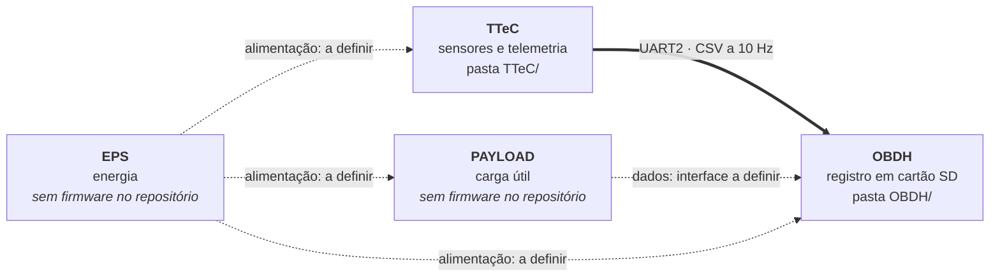
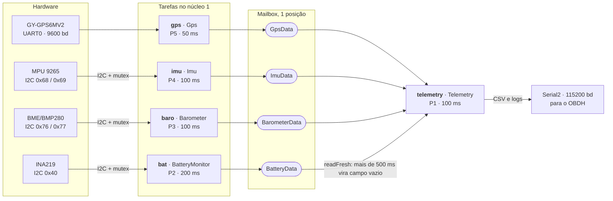
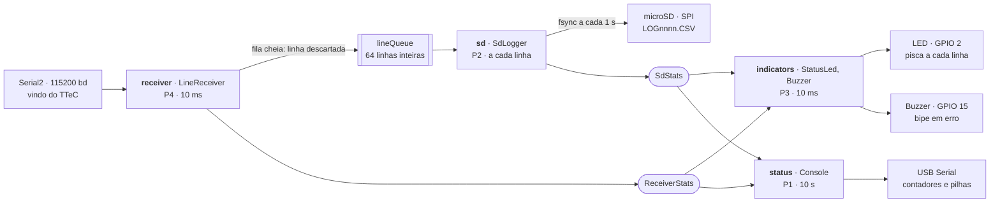

# Arquitetura do sistema

Visão geral das placas e da estrutura de software de cada firmware. Os diagramas usam Mermaid, que o GitHub desenha diretamente.

## Visão geral: as quatro placas



- **Linha grossa:** ligação implementada. **Tracejada:** ainda não definida no código.
- **Bateria:** o INA219 que mede a bateria está ligado ao I2C do TTeC, e os dados chegam ao OBDH nas colunas `bat_v`, `bat_ma` e `bat_mw`.
- **Portas livres no OBDH:** a UART2 recebe o TTeC e a UART0 é o console USB. Sobram a UART1 e o barramento SPI, que já é usado pelo cartão SD com CS no GPIO5. Definir as interfaces do EPS e do PAYLOAD exige escolher entre essas opções.

## TTeC: fluxo de dados



- As tarefas de leitura nunca esperam a telemetria: cada uma sobrescreve a sua `Mailbox`.
- O mutex I2C cobre o `sample()` inteiro de cada sensor, aplicado por `runI2cSensor`.
- Só a tarefa `telemetry` escreve na `Serial2`. Detalhes em `TTeC/FREERTOS.md`.

## OBDH: fluxo de dados



- A recepção nunca espera o cartão: a demora de gravação fica na tarefa `sd`.
- Uma fila cheia descarta linhas inteiras, que aparecem como salto no `id`.
- LED, buzzer e console só leem as estatísticas e não atrasam a recepção nem a gravação.

## Camadas de código

Cada camada chama apenas a de baixo. Só `RtosTasks.cpp` e `Mailbox.h` incluem cabeçalhos do FreeRTOS, então as classes dos módulos não sabem que existem tarefas.

| Camada | TTeC | OBDH |
|---|---|---|
| Orquestração | `TTeC.ino` | `OBDH.ino` |
| Tarefas e troca de dados | `RtosTasks.h/.cpp`, `Mailbox.h` | `RtosTasks.h/.cpp`, `Mailbox.h` (mesmo arquivo) |
| Módulos | `Gps`, `Imu`, `Barometer`, `BatteryMonitor`, `Telemetry` | `LineReceiver`, `SdLogger`, `StatusLed`, `Buzzer`, `Console` |
| Bibliotecas | TinyGPSPlus, Adafruit BMP280, BME280 e INA219, `Wire` | `SD`, `SPI`, LEDC, todas do pacote esp32 |
| Configuração | `ProjectConfig.h` | `ProjectConfig.h` |

## Contrato entre TTeC e OBDH

O formato da linha é a única dependência entre os dois projetos. O TTeC monta a linha em `Telemetry.cpp`, e o OBDH confere cada linha com `kCsvHeader` e `kCsvColumns` no seu `ProjectConfig.h`:

```csv
id,temp_c,press_hpa,hum_pct,ax_g,ay_g,az_g,gx_dps,gy_dps,gz_dps,mx_ut,my_ut,mz_ut,lat_deg,lon_deg,alt_m,sats,bat_v,bat_ma,bat_mw
```

Ao mudar uma coluna, altere os dois lados e grave as duas placas.
